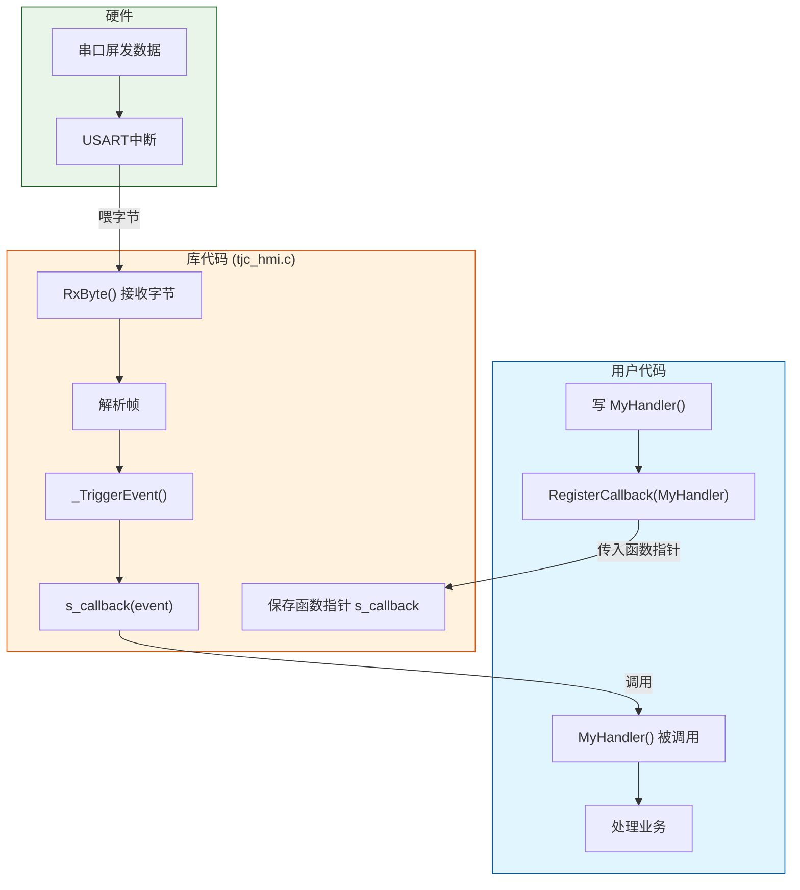
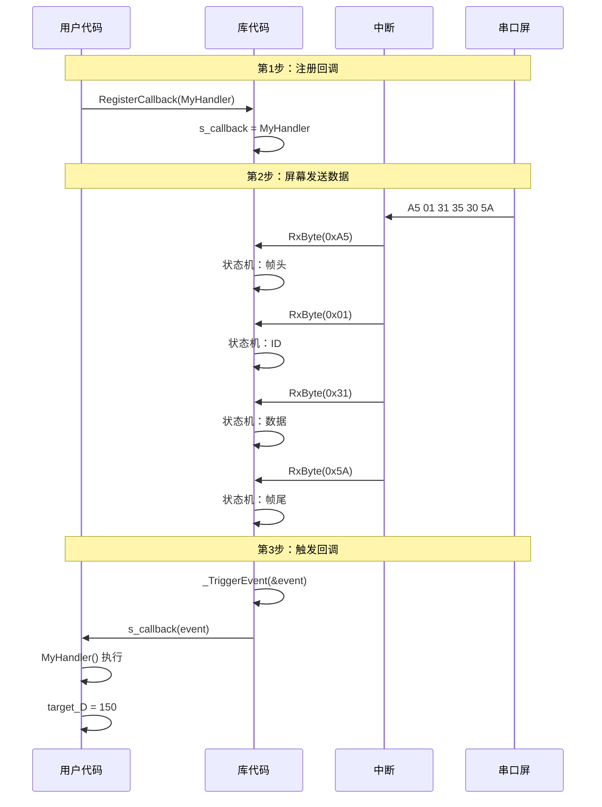
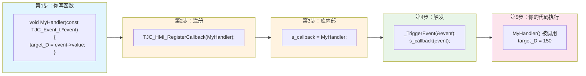

# TJC_HMI_Lib 回调函数机制详解

## 什么是回调函数

回调函数就是**你写的处理函数，库在特定时机自动调用它**。

类比理解：
- 你把电话号码留给快递柜 → `RegisterCallback(MyHandler)`
- 快递柜有快递时打电话给你 → `_TriggerEvent(event)`
- 你接电话去取快递 → `MyHandler()` 被调用

## 两个关键函数

| 函数 | 谁调用 | 作用 |
|------|--------|------|
| `RegisterCallback(MyHandler)` | 你 | 告诉库"我的函数在这" |
| `_TriggerEvent(event)` | 库内部 | 有数据时通知你，调用你的函数 |

## 执行流程

```
屏幕发数据 → 中断读字节 → 库解析帧 → 生成事件 → _TriggerEvent(&event) → MyHandler(&event) → 你的代码
```

## 事件是怎么传给回调的

**核心逻辑：** 库解析完一帧数据后，生成一个事件（`TJC_Event_t`），这个事件作为参数传给你的回调函数。

```c
// 1. 库内部解析完后，生成事件
static void _ParseGenericFrame(void)
{
    TJC_Event_t event;
    event.id = 1;           // 从帧里解析出 ID
    event.value = 150;      // 从帧里解析出数据
    event.type = TJC_EVENT_DATA;
    
    _TriggerEvent(&event);  // 把事件传给回调
}

// 2. _TriggerEvent 调用你的函数，事件作为参数
static void _TriggerEvent(const TJC_Event_t *event)
{
    s_callback(event);  // 你的函数收到事件
}

// 3. 你的回调函数收到事件，处理业务
void MyHandler(const TJC_Event_t *event)
{
    // event->id = 1, event->value = 150
    if (event->id == 1) {
        target_D = event->value;  // 处理业务
    }
}
```

**一句话：** 库解析完 → 生成事件 → 事件作为参数 → 传给你的回调函数 → 你处理业务。

## 代码示例

```c
// 第1步：你写回调函数
void MyHandler(const TJC_Event_t *event)
{
    target_D = event->value;  // 处理业务
}

// 第2步：注册回调
TJC_HMI_RegisterCallback(MyHandler);

// 第3步：库内部自动调用（你看不见）
// _TriggerEvent(&event) → s_callback(event) → MyHandler() 执行
```

## 回调函数流程图



## 详细执行流程



## 代码对照表



## 总结

| 概念 | 函数 | 谁调用 | 作用 |
|------|------|--------|------|
| 注册回调 | `RegisterCallback()` | 用户 | 告诉库"我的函数在这" |
| 触发回调 | `_TriggerEvent()` | 库内部 | 有数据时通知用户 |
| 回调函数 | `MyHandler()` | 库调用，用户写 | 处理业务逻辑 |

**一句话：** 你写函数，注册它，库有数据时自动调用它。
