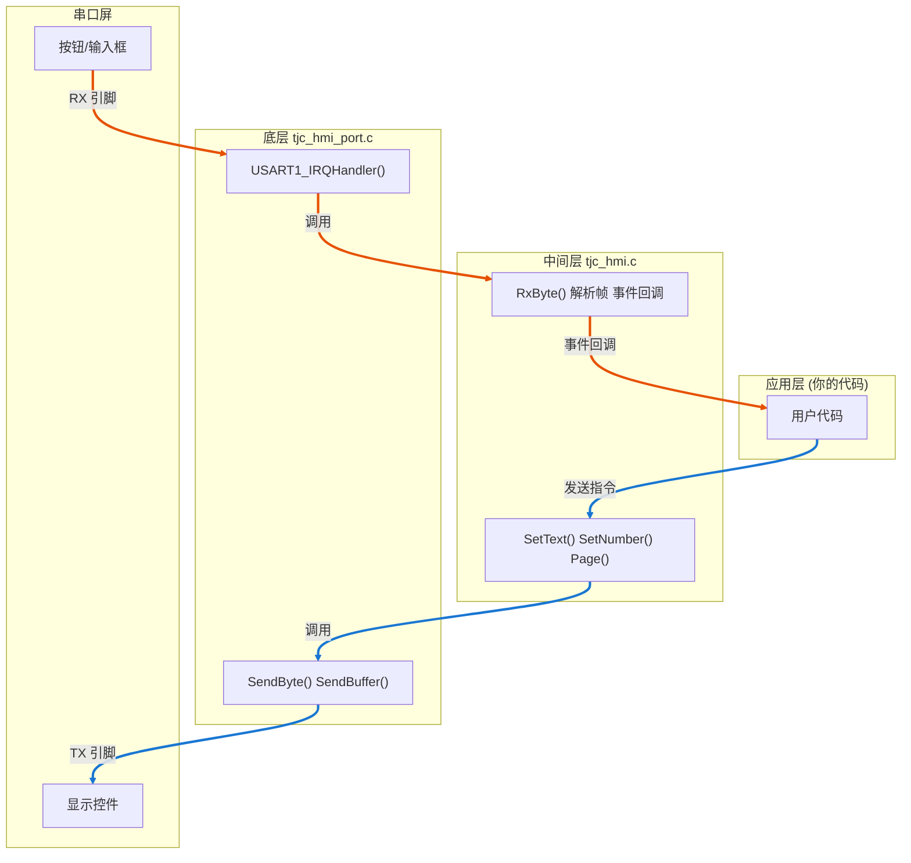
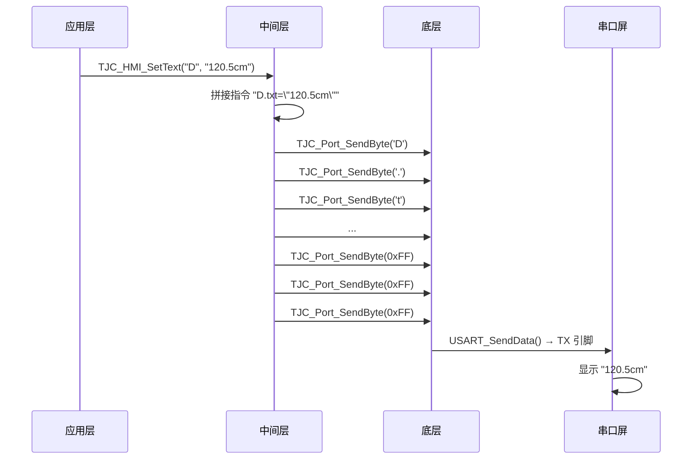
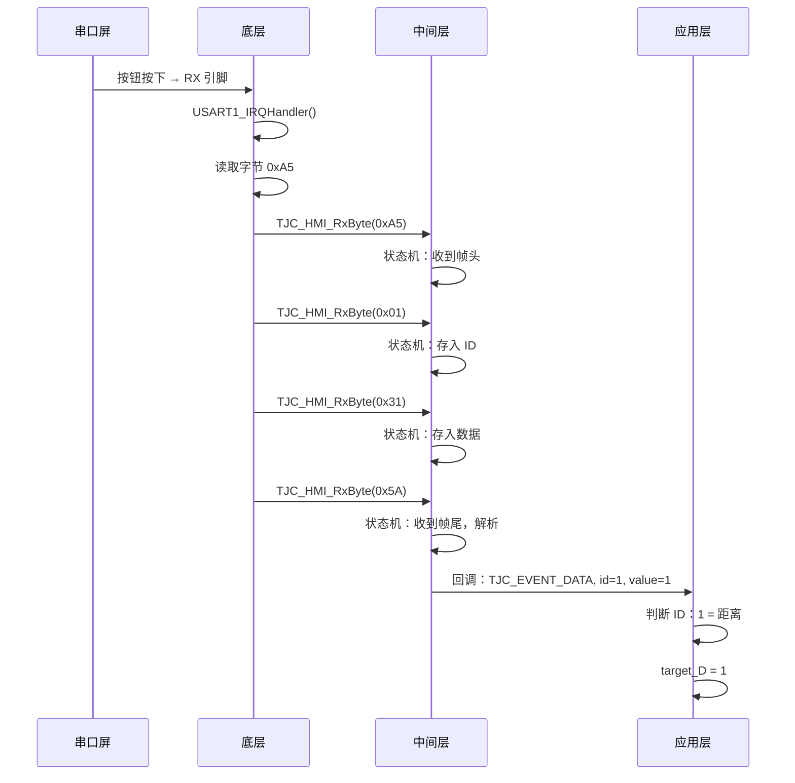
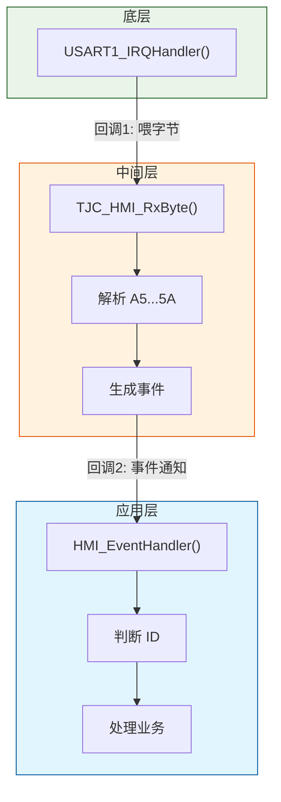

# TJC_HMI_Lib 分层架构流程图

## 架构总览

## 发送流程

## 接收流程

## 两个回调函数

## 分层职责

| 层 | 文件 | 职责 |
|----|------|------|
| 应用层 | 你的代码 | 定义 ID 含义、处理业务逻辑 |
| 中间层 | tjc_hmi.c | 协议解析、生成事件、控件操作 |
| 底层 | tjc_hmi_port.c | 串口初始化、收发字节、硬件操作 |

## 两个回调函数

| 回调 | 方向 | 作用 |
|------|------|------|
| `TJC_HMI_RxByte()` | 底层 → 中间层 | 喂入接收到的字节 |
| `TJC_HMI_Callback_t` | 中间层 → 应用层 | 通知事件（按钮/数据） |
