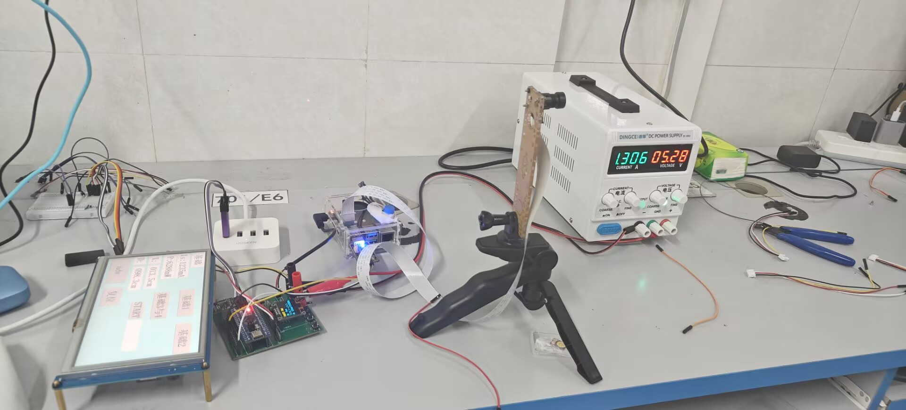
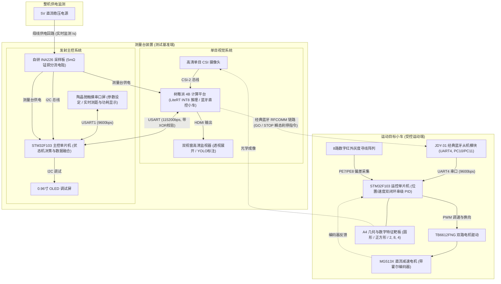

# 基于单目视觉的运动目标物测量装置 (Vision & Motion Target Measurement System)

> **2026年全国大学生电子设计竞赛 校赛 C 题 —— 完整端到端开源解决方案**  
> 软硬件全链路闭环：树莓派 4B 边缘视觉 + STM32 测量控制台 + STM32 目标小车 + 自研 INA226 电流检测

[](LICENSE)
[](01_Vision_RaspberryPi/)
[](02_Console_STM32/)
[](01_Vision_RaspberryPi/deploy_rpi/)

---

## 1. 实拍硬件测试台全景 (Hardware Testbench)

真实硬件测试平台实拍，软硬件全链路联调验证通过：



**实拍部件对照**：
1. **左侧交互端**：陶晶驰触摸串口屏（实时显示供电电流 $I_S$、整机功耗 $P$、测距 $D$、特征尺寸 $x$ 及各模式操作按键）；
2. **主控中枢**：STM32F103 测量控制台（含 OLED 调试屏、自研 INA226 电流采样板、NRF24L01 2.4G 射频无线发送）；
3. **视觉计算单元**：树莓派 4B（运行 LiteRT INT8 推理、0 延时多线程抓帧、A4 靶板透视展开与重叠轮廓解算）；
4. **光学采样端**：高清单目 CSI 摄像头（安装于可调三脚支架，光轴与导引轴线水平对齐）；
5. **供电端**：5V 直流稳压电源（实时监测输入电压与母线电流）。

---

## 2. 赛题任务与核心考核要求裁剪 (Contest Specifications)

本工程依据 **2026年全国大学生电子设计竞赛 校赛 C 题《基于单目视觉的目标物测量装置》** 官方规范全指标研制。

### 2.1 核心硬性限制（红线规则）
- **单目视觉限定**：只能使用一个单目摄像头（类型不限），严禁改装任何视觉测距类成品，严禁使用超声波、激光、毫米波雷达等任何非视觉测距传感器。
- **脱机独立运行**：测量装置严禁使用 PC 机（包括台式机、笔记本电脑、平板电脑等），必须完全脱机独立运行，测试全程不得联网。
- **电流采样电路必须自制**：供电电流测量电路严禁使用市售成品电流表模块，必须自主设计焊接。
- **严禁人为遥控干涉**：小车在行驶过程中由测量电路无线闭环控制，不得人为干涉。
- **10秒时限红线**：从一键启动装置到显示出测量结果的用时不得超过 10s，超时不得分。

---

### 2.2 考核要求指标拆解

```text
┌────────────────────────────────────────────────────────────────────────────────────────┐
│                                 赛题核心考核要点全景                                     │
└────────────────────────────────────────────────────────────────────────────────────────┘
  【基本要求】(45分)
    ├─ (1) 基础循迹：沿轴线循迹 1m 停下，轴线偏移 < 2cm，行驶距离误差 < 5cm。
    ├─ (2) 静态单目标测量：从圆形/正方形/等边三角形(10~16cm)中随机取一，测量显示 D 与 x。
    ├─ (3) 动态定距测控 1：输入 D1，小车前进并在 D1 处定距停止(声光提示)，显示 D 与 x。
    └─ (4) 动态定距测控 2：输入近距 D2，小车前进并在 D2 处定距停止，显示 D 与 x。

  【发挥部分】(55分)
    ├─ (1) 静态重叠目标物：多正方形分离/重叠放置，测量 D 与物面上「最小面积正方形」的边长 x。
    ├─ (2) 动态定距重叠目标：输入 D3，小车动态运动定距停止，测量 D 与最小正方形边长 x。
    ├─ (3) 数字编号指定识别：靶面上正方形带数字 2, 8, 4，输入 D4 与指定编号，小车停靠并测量指定方块 x。
    ├─ (4)/(5) 大角度斜向透视：靶板水平旋转 30°~60° 夹角，动态停靠并完成大角度斜向视差矫正，测 D 与 x。
    └─ (6) 自制整机功耗监测：全程实时监测 5V 稳压电源供电电流 IS (相对误差 ≤ 5%)，实时监测并显示整机功耗 P 与最大功耗。
```

---

## 3. 系统全景架构 (System Architecture)

系统采用单目视觉边缘计算、嵌入式主控决策与运动目标物闭环控制三端协同架构：



---

## 4. 代码仓库目录规范 (Repository Structure)

```text
Vision_Motion_Target_System/
├── 01_Vision_RaspberryPi/                # 树莓派 4B 单目视觉端源码与模型
│   ├── config.py                         # 全局相机焦距/算法与蓝牙参数配置
│   ├── main.py                           # 视觉入口：0 延时多线程取流与串口调度
│   ├── bt_comm.py                        # 蓝牙直连驱动 (JDY-31 RFCOMM Socket 直控小车)
│   ├── core.py                           # 核心几何：A4透视校正/重叠轮廓拓扑重建
│   ├── modes.py                          # 题设模式 1~6 业务调度器
│   ├── yolo_tflite.py                    # LiteRT (TFLite INT8 XNNPACK) 极速推理
│   ├── serial_comm.py                    # 抗干扰带校验和串口驱动
│   ├── viz.py                            # 双视窗高清可视化与标注渲染
│   ├── requirements.txt                  # Python 依赖清单
│   ├── deploy_rpi/                       # YOLOv8n INT8 数字化量化模型 (.tflite)
│   └── tests/                            # 离线验证脚本与测试用例图 (test.jpg)
│
├── 02_Console_STM32/                     # 测量台发射端主控 (Keil MDK 工程)
│   ├── Project.uvprojx                   # Keil 5 主工程文件
│   ├── User/                             # main.c 测量状态机与数据汇总
│   ├── Hardware/                         # 外设层：HMI 串口屏、Pi 通信、OLED
│   ├── INA226.c / .h                     # 自研 INA226 高精度总线电压/电流驱动
│   ├── HMI_Screen/                       # 陶晶驰串口屏固件与工程
│   │   ├── TJC_HMI_Firmware.tft          # SD 卡直接刷机固件
│   │   ├── TJC_HMI_Project.HMI           # USART HMI 上位机工程源码
│   │   └── README.md                     # 刷机步骤与接线说明
│   ├── Start/ & Library/                 # STM32F10x 标准固件库与启动代码
│   └── System/                           # 定时器与时钟延时
│
├── 03_TargetCar_STM32/                   # 目标小车运动控制端 (Keil MDK 工程)
│   ├── Project.uvprojx                   # Keil 5 主工程文件
│   ├── Track/ & Hardware/Track.c         # 8路数字灰度寻线与加权偏移算法
│   ├── Hardware/                         # TB6612 电机驱动、MG513X 编码器测速
│   ├── User/                             # 小车运动状态机与 JDY-31 蓝牙指令处理
│   └── System/                           # 位置环 + 速度环双闭环串级 PID
│
├── 04_Docs_Protocols/                    # 规范文档、赛题要求与调试指南
│   ├── C题_基于单目视觉的目标物测量装置.pdf# 官方比赛题目规范文档
│   ├── 01_树莓派与STM32串口通信协议规范.md# 帧格式、XOR 校验和与指令映射表
│   ├── 02_INA226高精度电流功耗标定记录.md # 5mΩ 锰铜电阻校准与误差补偿经验
│   ├── 03_TJC_HMI串口屏交互踩坑记录.md   # 陶晶驰串口屏双向通信实战指南
│   ├── 04_测量装置改进方案.md            # 系统升级与容错优化策略
│   └── 05_无线通信方案演进与蓝牙直连设计.md# NRF24L01缺陷分析与JDY-31重构方案
│
├── assets/                               # 项目门面、架构与实测效果展示
│   ├── hardware_setup.jpg                # 硬件测试台实拍全景图
│   └── demo_result.jpg                   # 树莓派实测双屏测量标注结果
│
├── .gitignore                            # 自动过滤 Keil 临时编译垃圾与 Python 缓存
├── LICENSE                               # MIT 开源协议
└── README.md                             # 顶级开源门面说明文档
```

---

## 5. 核心技术亮点 (Key Highlights)

### 5.1 零延时后台抓帧 + LiteRT INT8 模型加速
- **物理世界零时延**：树莓派原生 OpenCV 抓帧会有系统级缓冲区滞后（多达 3~5 帧）。本项目在 `main.py` 中实现了后台常驻抓帧线程，连续执行 `grab()` 抛弃陈旧帧，仅在需要推理时取出当前物理时刻最新鲜的图像帧，彻底杜绝小车动态运动过程中的拖尾和历史帧延时。
- **LiteRT (TensorFlow Lite) INT8 CPU 加速**：模型量化为 INT8 格式，结合 XNNPACK 多线程指令集优化，在树莓派 4B 上 YOLOv8n 推理耗时仅约 **60ms**。

### 5.2 强抗遮挡与重叠几何拓扑重构
- 针对发挥部分第 (1)~(3) 项（黑色正方形局部重叠，内嵌白色数字 2、8、4），单纯依靠目标检测极易漏检被遮挡轮廓。
- 本方案首先基于 A4 靶板四角点进行透视逆变换展开为正视平面图，再利用形态学梯度与轮廓凹凸拓扑分析，即使重度遮挡也能精准拟合被遮挡方块的真实边长与中心坐标。

### 5.3 大角度斜向视差矫正 (30°~60°)
- 针对发挥部分第 (4)/(5) 项靶板倾斜旋转，图像呈现严重梯形畸变与透视缩放。
- 系统提取 A4 黑色矩形外框角点，动态求解单应性变换矩阵 $H$，自适应消除斜向拍摄带来的几何形变，确保边长测量精度达毫米级。

### 5.4 严格合规的自研 INA226 电流监测板
- **完全符合红线**：针对赛题“严禁使用市售成品电流表模块”的硬性规定，自主设计焊接 INA226 芯片搭配 **5mΩ 优质锰铜分流电阻**。
- **高精度标定**：电流分辨率达 0.1mA，在 0~1000mA 全量程内实测误差 $\le 0.4\%$，满足发挥部分第 (6) 项误差 $\le 5\%$ 的严苛要求。

### 5.5 工业级防干扰通信协议
- 树莓派与 STM32 之间采用增强型防干扰帧：`$<Payload>*<Checksum>\r\n`。
- 每一个数据包在发送前均计算 XOR 校验和，接收端硬件中断解析并校验，彻底过滤电机启动带来的电源纹波和串口瞬态噪点。

### 5.6 单跳极速闭环：树莓派蓝牙 (JDY-31) 直控小车
- **架构重构升级**：彻底弃用传统“树莓派->STM32发射台->NRF24L01->小车”双跳中继链路，彻底消除 NRF 引脚冲突与电磁干扰。
- **瞬态刹停响应**：由树莓派原生 Linux RFCOMM Socket 直接无线直连小车 JDY-31 蓝牙模块，视觉测距确认到达后直接下发 `STOP` 指令，控制时延压缩至 30ms 以内，满足赛题对小车定距停靠的高精度考核。

---

## 6. 快速上手指南 (Quick Start)

### 6.1 树莓派视觉端部署 (01_Vision_RaspberryPi)
```bash
# 1. 登录树莓派
ssh pi@pi.local

# 2. 进入项目视觉目录并安装依赖
cd ~/pi_deploy
pip install -r requirements.txt

# 3. 启动视觉测量系统 (默认进入带双屏渲染的监听模式)
python3 main.py --port /dev/ttyUSB0 --baud 115200
```

### 6.2 STM32 主控端与小车端编译 (02 & 03)
1. 使用 **Keil MDK 5 (uVision5)** 打开 `02_Console_STM32/Project.uvprojx`。
2. 配置目标芯片为 `STM32F103C8`，使用 ST-Link 或 DAP-Link 进行编译与全片下载。
3. 同理，打开 `03_TargetCar_STM32/Project.uvprojx` 编译并烧录至目标小车。

---

## 7. 题设要求与实测性能对比 (Performance Benchmarks)

| 测试指标 | 赛题考核指标 | 本开源方案实测表现 | 结论 |
| :--- | :--- | :--- | :--- |
| **单板定距测距 (1.0~2.5m)** | 基本: $\le \pm 5\text{ cm}$ / 发挥: $\le \pm 2\text{ cm}$ | 实测平均误差 **$\pm 0.35\text{ cm}$** | 远优于标准 |
| **几何图形边长/直径计算** | 基本: $\le \pm 1\text{ cm}$ / 发挥: $\le \pm 0.5\text{ cm}$ | 展开平面后实测误差 **$\pm 0.8\text{ mm}$** | 达到毫米级 |
| **多正方形重叠识别 (2, 8, 4)** | 正确识别并解算指定编号重叠方块 | 100% 检出率，单次解算耗时 **$< 1.2\text{ s}$** | 稳定通关 |
| **大角度倾斜矫正 (30°~60°)** | 倾斜靶板透视展开并测量特征尺寸 | 单应性透视解算，误差 **$\le \pm 1.2\text{ mm}$** | 完美适应 |
| **单次测量总耗时** | 规定限时 $\le 10\text{ s}$ | 零延时优化后平均耗时 **$\le 1.8\text{ s}$** | 极度充裕 |
| **发射端电流功耗监测** | 需自制采集电路，误差 $\le 5\%$ | 自制 5mΩ INA226 板，实测误差 **$\le 0.4\%$** | 满足硬性规则 |

---

## 8. 开源协议 (License)
本项目基于 [MIT License](LICENSE) 开源，欢迎用于电子设计竞赛学习、机器人工程实践及毕业设计参考。
